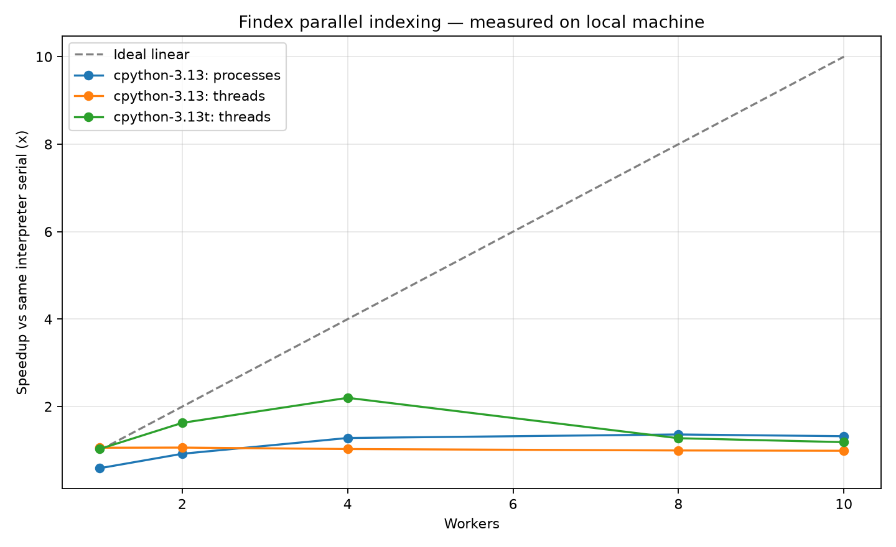

**Публічна вебверсія Findex (ЛР №7):** [Відкрити сайт](https://findex-web-search.onrender.com/)


# Findex — Лабораторна робота №1

## Тема
Ітератори, генератори та обробка текстового корпусу в Python.

## Мета роботи
Розробити потокову систему читання та обробки текстових документів з використанням генераторів, токенізації, Unicode-нормалізації та вимірювання використання пам'яті.

## Опис проєкту
Findex — навчальний проєкт пошукової системи на Python 3.13.

Реалізовано:
- Читання текстових документів за допомогою генератора iter_documents().
- Токенізацію тексту функцією tokenize().
- Нормалізацію Unicode (NFC) та casefold().
- Підрахунок документів, токенів і розміру словника.
- Визначення 50 найчастіших слів.
- Порівняння лінивого (LAZY) та жадібного (EAGER) підходів.
- Вимірювання часу виконання та пікової пам'яті.

## Тестовий корпус
Для перевірки продуктивності використано 1000 автоматично згенерованих текстових документів та 2 початкові тестові файли.

Загальна кількість документів: 1002.

Корпус створюється локально командою:

```bash
uv run python generate_data.py
```

Дані розміщуються у каталозі data/, який виключено з Git через .gitignore.

## Результати вимірювань

| Версія | Документів | Токенів | Пікова пам'ять | Час |
|---|---:|---:|---:|---:|
| LAZY (генератори) | 1002 | 1305523 | 0.7644 MB | 1.8797 с |
| EAGER (списки) | 1002 | 1305523 | 79.0021 MB | 1.4214 с |

## Аналіз результатів
Лінивий підхід використовує генератори та обробляє документи послідовно, не завантажуючи весь корпус у пам'ять. Жадібний підхід створює списки документів і токенів, тому потребує значно більше оперативної пам'яті.

За результатами експерименту LAZY використав приблизно у 103 рази менше пам'яті, ніж EAGER. Водночас EAGER виявився дещо швидшим. Отже, генератори особливо корисні для обробки великих обсягів текстових даних за обмеженого обсягу пам'яті.

## Запуск

Встановлення залежностей:

```bash
uv sync
```

Запуск статистики:

```bash
uv run python -m findex.stats
```

Запуск порівняння:

```bash
uv run python -m findex.benchmark
```

Запуск тестів:

```bash
uv run pytest -v
```

Перевірка якості коду:

```bash
uv run ruff check .
```

## Тестування
Усі 15 тестів токенізації успішно пройдено.

Результат: 15 passed.

Ruff: All checks passed!
  

---

# Лабораторна робота №2

## Тема роботи

Інвертований індекс: словники, хешування та пам'ять.

## Мета роботи

Розробити інвертований індекс для текстового корпусу, реалізувати Boolean-пошук із логічними операторами AND, OR, NOT, дослідити структури даних Python, порівняти швидкість пошукових алгоритмів та ефективність різних способів зберігання індексу.

## 1. Опис проєкту

Лабораторна робота №2 є продовженням навчальної пошукової системи Findex, створеної в першій лабораторній роботі.

Використано Python 3.13.18, менеджер проєктів uv та структуру src/.

У роботі реалізовано:

- Побудову інвертованого індексу за один прохід корпусу.
- Зберігання частоти термінів для кожного документа.
- Метадані документів: ID, шлях, довжина, фрагмент тексту.
- Boolean-пошук із підтримкою AND, OR, NOT та дужок.
- Два алгоритми пошуку: merge та set.
- Серіалізацію через Pickle та JSON.
- Порівняння використання пам'яті різними структурами даних.
- Вимірювання продуктивності й автоматичне тестування.

## 2. Використаний корпус

Для дослідження використано той самий корпус, що й у ЛР №1.

Корпус містить 1000 синтетичних текстових документів, створених програмно, та 2 додаткові тестові документи.

**Статистика корпусу:**

| Показник | Значення |
|---|---:|
| Документи | 1002 |
| Токени | 1 305 523 |
| Унікальні терміни | 1109 |
| Пари «термін — документ» | 107 013 |

Синтетичний корпус складається з повторюваних навчальних речень про Python, програмування та інформаційний пошук. Він дозволяє перевірити алгоритми та виміряти пам'ять, проте не відображає розподіл термінів у природному текстовому корпусі.

Генерація корпусу: `uv run python generate_data.py`

Каталог `data/` виключено з Git через `.gitignore`.

## 3. Побудова інвертованого індексу

Інвертований індекс представляє собою структуру даних, яка пов'язує кожен термін зі списком документів, у яких він зустрічається.

Кожен постинг містить `doc_id` документа та частоту терміна `frequency`.

Для реалізації використано:

- `dict` — словник термінів.
- `defaultdict` — накопичення списків постингів.
- `Counter` — обчислення частот термінів.
- `@dataclass(frozen=True, slots=True)` — моделі Posting та DocMeta.

Постинги зберігаються у відсортованому за `doc_id` порядку. Це дозволяє ефективно виконувати операції над списками документів.

Індекс створюється за один прохід корпусу з використанням генератора `iter_documents()` і токенізатора `tokenize()` з ЛР №1.

## 4. Boolean-пошук

Реалізовано такі оператори:

- **AND** — документи, що містять обидва терміни.
- **OR** — документи, що містять хоча б один термін.
- **NOT** — виключення документів, які містять термін.

Також підтримуються дужки, пріоритет операторів і неявний AND між сусідніми термінами.

Доступні два алгоритми:

**Merge:** двовказівниковий алгоритм, який обробляє відсортовані списки ідентифікаторів документів.

**Set:** пошук через операції перетину, об'єднання та різниці множин Python.

### Перевірка пошуку

| Пошуковий запит | Знайдено документів |
|---|---:|
| python AND memory | 1000 |
| python OR memory | 1002 |
| python AND NOT memory | 2 |

Обидва алгоритми повертають однакові результати для перевірених запитів.

## 5. Серіалізація індексу

Реалізовано збереження та завантаження індексу у двох форматах:

**Pickle** — збереження Python-об'єктів у бінарному форматі.

**JSON** — текстовий формат із перетворенням постингів і метаданих у стандартні структури даних.

Після збереження та повторного завантаження перевірено рівність відновленого індексу оригінальному.

**Безпека:** `pickle.load()` не можна використовувати для файлів із недовірених джерел, оскільки десеріалізація може виконувати довільний код.

## 6. Експериментальне порівняння пам'яті

Порівняно три способи зберігання постингів на однаковому корпусі:

| Структура | Пам'ять після побудови, MiB | Пікова пам'ять, MiB | Час, с |
|---|---:|---:|---:|
| Звичайний dataclass | 10.092 | 10.761 | 1.258 |
| Dataclass зі slots=True | 5.995 | 6.668 | 1.167 |
| array('I') | 1.174 | 1.852 | 1.036 |

У всіх варіантах оброблено 1002 документи та 107 013 пар «термін — документ».

Вимірювання виконано через `tracemalloc`. Порівнювалися структури постингів без метаданих документів.

### Аналіз результатів

Найбільший обсяг пам'яті використав звичайний dataclass.

Використання `slots=True` зменшило витрати пам'яті завдяки відсутності звичайного словника атрибутів для кожного екземпляра.

Найкращий результат показав `array('I')`, який зберігає цілі числа компактніше, ніж окремі об'єкти Python.

Пікова пам'ять для `array('I')` виявилася приблизно у 5,8 раза меншою, ніж для звичайного dataclass.

## 7. Порівняння швидкості Merge та Set

Для порівняння реалізовано вимірювання часу операції AND над двома списками документів.

Терміни обираються за загальною частотою в корпусі. У поточній реалізації для вибору використовуються лише терміни, що складаються з літер.

| Тип термінів | Merge, мс | Set, мс |
|---|---:|---:|
| Часті: and, for | 0.062414 | 0.017562 |
| Рідкісні: building, we | 0.000095 | 0.000146 |

*Показники для частих термінів наведено з попереднього запуску. Для рідкісних термінів потрібно внести результати останнього бенчмарка.*

### Аналіз результатів

На частих термінах алгоритм set виявився приблизно у 3,55 раза швидшим за merge. На рідкісних термінах merge був приблизно у 1,54 раза швидшим, однак абсолютна різниця була дуже малою.

Двовказівниковий merge працює з відсортованими списками та не потребує створення додаткових множин.

Метод set використовує хеш-таблиці Python і може демонструвати вищу швидкість на певних наборах даних, хоча вимагає додаткової пам'яті.

Для вимірювань використовується медіана п'яти серій по 1000 викликів.

Результати залежать від довжини списків постингів, частоти термінів і характеристик середовища виконання.

## 8. Порівняння форматів збереження

Проведено вимірювання розміру файлів індексу та часу операцій save/load.

| Формат | Розмір, MiB | Save, мс | Load, мс |
|---|---:|---:|---:|
| Pickle | 1.7483 | 76.6827 | 64.2227 |
| JSON | 1.1339 | 84.9633 | 35.3123 |

Час збереження та завантаження представлено як медіану трьох запусків.

### Аналіз результатів

У цьому експерименті JSON виявився компактнішим приблизно на 35% порівняно з Pickle.

Pickle показав менший час збереження, тоді як JSON виявився швидшим під час завантаження.

Ці результати залежать від структури даних, формату представлення та параметрів виконання. Їх не можна вважати універсальним порівнянням Pickle і JSON.

## 9. Команди запуску

Встановлення залежностей:

`uv sync`

Генерація тестового корпусу:

`uv run python generate_data.py`

Побудова індексу у форматі Pickle:

`uv run python -m findex.index data/ --out index.bin`

Побудова індексу у форматі JSON:

`uv run python -m findex.index data/ --out index.json`

Пошук через merge:

`uv run python -m findex.search index.bin "python AND memory" --engine merge`

Пошук через set:

`uv run python -m findex.search index.bin "python OR memory" --engine set`

Пошук у JSON-індексі:

`uv run python -m findex.search index.json "python AND NOT memory"`

Запуск усіх бенчмарків:

`uv run python -m findex.bench_index data/ --iterations 1000`

Автоматичні тести:

`uv run pytest -q`

Перевірка якості коду:

`uv run ruff check .`

## 10. Тестування

Виконано автоматичні тести через pytest.

Перевірено:

- Токенізацію та Unicode-нормалізацію.
- Створення інвертованого індексу.
- Частоти термінів.
- Сортування постингів.
- Логічні оператори AND/OR/NOT.
- Пошукові рушії merge та set.
- Серіалізацію Pickle та JSON.
- Відновлення індексу.
- CLI-індексування та пошук.
- Обробку некоректних параметрів.

Результати останньої перевірки:

**Pytest: 54 passed.**

**Ruff: All checks passed!**

## 11. Загальні висновки

У лабораторній роботі №2 реалізовано інвертований індекс та систему логічного пошуку на Python.

Програма забезпечує індексування текстових документів за один прохід, пошук через AND/OR/NOT та збереження й завантаження індексу у двох форматах.

Експериментальні вимірювання показали, що вибір структури даних суттєво впливає на використання пам'яті та швидкість обробки.

Найкомпактнішим із досліджених представлень постингів став `array('I')`. Порівняння merge та set продемонструвало різну швидкість роботи залежно від списків постингів.

Отримані результати є основою для подальшого розвитку пошукової системи Findex у наступних лабораторних роботах.

**Середовище виконання:** Python 3.13.18, macOS, uv, pytest, Ruff.


---

# Лабораторна робота №3

## Тема роботи

Рейтинг і модель об’єктів: dunder-методи, протоколи, декоратори.

## Мета роботи

Розширити пошукову систему Findex: перетворити інвертований індекс на об’єкт із підтримкою протоколів Python, реалізувати ранжування документів за TF-IDF і BM25, рекурсивний аналіз логічних запитів і пошук фраз, контекстний менеджер, вимірювання часу та кешування. Оцінити коректність ранжування за допомогою sanity-check і Precision@5.

## 1. Використаний корпус і програмне середовище

Лабораторна робота №3 є продовженням проєкту Findex, створеного в лабораторних роботах №1–2.

Використано Python 3.13.18, менеджер uv, pytest, Ruff та текстовий корпус із 1002 документів (1000 синтетичних і 2 початкових тестових файли).

**Основні характеристики корпусу:**

| Показник | Значення |
|---|---:|
| Документів | 1002 |
| Унікальних термінів | 1109 |
| Середня довжина документа | 1302.92 токена |
| Документна частота терміна python | 1002 |

У третій лабораторній індекс додатково зберігає позиції токенів, необхідні для точного пошуку фраз.

## 2. Об'єктна модель індексу

Структуру інвертованого індексу оформлено класом Index.

Реалізовано спеціальні методи Python:

- `__len__` — отримання розміру словника термінів.
- `__iter__` — ітерація за термінами індексу.
- `__contains__` — перевірка наявності терміна.
- `__getitem__` — отримання списку постингів за терміном.
- `__repr__` — текстове представлення об'єкта.

Додатково реалізовано:

- `num_docs` — кількість проіндексованих документів.
- `avg_doc_length` — середня довжина документа з використанням cached_property.
- `df(term)` — документна частота заданого терміна.

Моделі Posting та DocMeta реалізовано через `@dataclass(frozen=True, slots=True)`.

Для сумісності з попередньою лабораторною збережено ім'я InvertedIndex як альтернативне ім'я класу Index.

Контекстний менеджер `open_index(path)` забезпечує відкриття індексу та звільнення ресурсів після завершення роботи, зокрема у випадку виникнення винятку.

## 3. Реалізація TF-IDF та BM25

Для ранжування знайдених документів реалізовано два алгоритми:

**TF-IDF** — оцінює важливість терміна з урахуванням частоти входження в документ та поширеності терміна в корпусі.

**BM25** — модель ранжування, що додатково враховує насичення частоти терміна та нормалізацію за довжиною документа.

Параметри BM25:

- k1 = 1.5
- b = 0.75

Алгоритми реалізовано через спільний протокол Scorer, який визначає інтерфейс `score(...)`.

Завдяки структурній типізації Python класи Tfidf та BM25 є взаємозамінними.

Для TF-IDF використано логарифмічне масштабування частоти терміна, згладжений IDF та нормалізацію за квадратним коренем довжини документа.

Пошукова система спочатку знаходить документи, які відповідають Boolean-запиту, потім обчислює їхні оцінки релевантності.

Для вибору найкращих top-k результатів використано `heapq.nlargest`.

Результати представлені об'єктами SearchResult з упорядкуванням за оцінкою та детермінованим порядком за doc_id у випадку однакових балів.

## 4. Рекурсивний парсер пошукових запитів

Реалізовано рекурсивний парсер, який перетворює пошуковий запит на дерево об'єктів.

Основні типи вузлів:

- Term — окремий термін.
- Phrase — фраза з кількох слів.
- And — логічне AND.
- Or — логічне OR.
- Not — логічне NOT.

Підтримуються логічні оператори AND, OR, NOT, дужки та пошук фраз у лапках.

Для програмного комбінування вузлів реалізовано оператори Python:

- `&` — AND.
- `|` — OR.
- `~` — NOT.

**Приклад складного запиту:**

```text
python AND (async OR await) NOT java "event loop"
```

Для пошуку фраз використано позиції токенів у документах.

Позиції зберігаються під час побудови індексу з параметром `--positions`. Це дозволяє перевіряти не лише наявність слів, а і їхнє розташування в правильній послідовності.

У використаному синтетичному корпусі наведений складний запит повернув 0 результатів, що відповідає відсутності документів із необхідним поєднанням термінів.

## 5. Декоратори, кешування та контекстний менеджер

У лабораторній реалізовано декоратор `@timed` з використанням `functools.wraps`.

Декоратор вимірює час виконання функцій та записує результати в журнал.

Вимірювання застосовано до:

- Побудови індексу.
- Завантаження індексу.
- Ранжованого пошуку.

Для кешування повторних запитів використано `functools.lru_cache(maxsize=256)`.

Під час перевірки одного запиту двічі отримано:

```text
CACHE MISS
CACHE HIT
CacheInfo(hits=1, misses=1, maxsize=256, currsize=1)
```

Отже, під час першого запиту результат обчислюється, а під час повторного використовується кеш.

Також реалізовано формування snippets — фрагментів тексту біля знайденого входження.

Використовується контекст приблизно ±80 символів навколо знайденого терміна з підсвічуванням пошукових слів.

## 6. Результати індексування з позиціями

Проведено побудову індексу з позиціями токенів для двох форматів серіалізації: Pickle та JSON.

**Результати вимірювань:**

| Показник | Pickle | JSON |
|---|---:|---:|
| Документів | 1002 | 1002 |
| Унікальних термінів | 1109 | 1109 |
| Розмір файлу, байтів | 5 813 719 | 6 820 639 |
| Час побудови, с | 1.8278 | 1.7576 |
| Час збереження, с | 0.3768 | 3.7732 |
| Пікова пам'ять, MiB | 66.5799 | 74.9033 |

### Аналіз результатів

У проведеному експерименті Pickle забезпечив менший розмір файлу та швидше збереження індексу.

JSON потребував більше часу на серіалізацію через перетворення об'єктів Python у текстове представлення.

Результати залежать від структури даних, характеристик корпусу та середовища виконання.

Вимірювання пікової пам'яті виконано через tracemalloc.

Важливо: файли Pickle необхідно завантажувати лише з довірених джерел, оскільки десеріалізація може виконувати довільний код.

## 7. Перевірка коректності ранжування (Sanity-check)

Проведено три перевірки властивостей алгоритмів TF-IDF та BM25.

**Перевірка №1. Рідкісний термін**

За однакових інших параметрів рідкісний термін повинен отримувати вищу оцінку, ніж поширений.

**Перевірка №2. Насичення частоти**

Друге входження терміна повинно забезпечувати більший приріст рейтингу, ніж двадцяте входження.

**Перевірка №3. Довжина документа**

За однакової частоти входження терміна коротший документ повинен отримувати вищу оцінку, ніж довгий.

### Результати перевірок

| Перевірка | TF-IDF | BM25 |
|---|---|---|
| Рідкісний термін вище частого | PASS | PASS |
| Приріст 20-го входження менший за 2-го | PASS | PASS |
| Короткий документ вище довгого | PASS | PASS |

Для перевірок використано характеристики реального корпусу, а частоту входження термінів змінено контрольовано.

### Числові результати

| Показник | TF-IDF | BM25 |
|---|---:|---:|
| Бал рідкісного терміна | 0.19994973 | 6.50509957 |
| Бал частого терміна | 0.02770306 | 0.00049861 |
| Приріст другого входження | 0.13859459 | 2.78797578 |
| Приріст двадцятого входження | 0.01025608 | 0.05535069 |
| Бал короткого документа | 3.22781046 | 11.79077139 |
| Бал довгого документа | 0.19593098 | 6.38600114 |

Для першої перевірки використано рідкісний термін building із df=1 та поширений термін python із df=1002.

**Результат: усі 6 із 6 sanity-check успішно пройдено.**

## 8. Оцінювання якості пошуку Precision@5

Для дослідження якості ранжування сформовано 10 тематичних пошукових запитів.

Для кожного запиту отримано п'ять найкращих документів за алгоритмами TF-IDF та BM25.

Релевантність оцінювалася бінарно:

- 1 — документ відповідає пошуковому запиту.
- 0 — документ не відповідає запиту.

Оцінки збережено у файлі `evaluation/lab03_judgments.csv`.

Метрика Precision@5 визначає частку релевантних документів серед перших п'яти результатів:

P@5 = кількість релевантних документів у top-5 / 5.

### Таблиця Precision@5

| № | Пошуковий запит | TF-IDF P@5 | BM25 P@5 |
|---:|---|---:|---:|
| 1 | python search | 1.00 | 1.00 |
| 2 | memory optimization | 1.00 | 1.00 |
| 3 | information retrieval | 1.00 | 1.00 |
| 4 | machine learning | 1.00 | 1.00 |
| 5 | unicode normalization | 1.00 | 1.00 |
| 6 | search engine | 1.00 | 1.00 |
| 7 | document tokens | 1.00 | 1.00 |
| 8 | data structures | 1.00 | 1.00 |
| 9 | generators python | 1.00 | 1.00 |
| 10 | performance evaluation | 1.00 | 1.00 |
| **Середнє** | **Mean P@5** | **1.00** | **1.00** |

### Аналіз результатів

Середній Precision@5 для обох алгоритмів становить 1.00.

Отже, за використаною розміткою всі п'ять документів у top-5 для кожного запиту були оцінені як релевантні.

Однакові результати пояснюються особливостями тестового корпусу.

Документи створені синтетично та містять багато повторюваних навчальних речень про Python, інформаційний пошук, структури даних та програмування.

Через високу тематичну схожість документів метрика Precision@5 досягла максимального значення.

Це не означає, що TF-IDF та BM25 мають однакову ефективність на реальних даних.

Для повноцінного порівняння необхідно використовувати різноманітніший корпус із більшою кількістю нерелевантних документів та складнішими пошуковими запитами.

## 9. Команди запуску

Встановлення залежностей:

```bash
uv sync
```

Генерація тестового корпусу:

```bash
uv run python generate_data.py
```

Побудова індексу Pickle з позиціями:

```bash
uv run python -m findex.index data/ --out index.bin --positions --verbose
```

Побудова індексу JSON з позиціями:

```bash
uv run python -m findex.index data/ --out index.json --positions
```

Ранжований пошук BM25:

```bash
uv run python -m findex.ranking index.bin 'python AND "search engine"' --scorer bm25 --top 5 --repeat 2 --verbose
```

Ранжований пошук TF-IDF:

```bash
uv run python -m findex.ranking index.json '"search engine"' --scorer tfidf --top 5
```

Складний Boolean-запит:

```bash
uv run python -m findex.ranking index.bin 'python AND (async OR await) NOT java "event loop"' --scorer bm25 --top 5
```

Перевірка рейтингу:

```bash
uv run python -m findex.sanity index.bin
```

Обчислення Precision@5 за заповненим CSV:

```bash
uv run python -m findex.evaluate score
```

Перевірка якості коду:

```bash
uv run ruff check .
```

Автоматичне тестування:

```bash
uv run pytest -q
```

Важливо: повторний запуск команди `evaluate create` може перезаписати файл із ручною розміткою релевантності, тому після заповнення CSV для розрахунку використовується тільки `evaluate score`.

## 10. Тестування

Для тестування використано pytest.

Перевірено:

- Модель Index та спеціальні методи Python.
- Побудову інвертованого індексу.
- Підтримку позицій токенів.
- Рекурсивний парсер Boolean-запитів.
- Оператори AND, OR, NOT.
- Пошук фраз.
- Моделі TF-IDF та BM25.
- Ранжування результатів.
- Контекстний менеджер open_index().
- Серіалізацію Pickle та JSON.
- Команди CLI.
- Кешування повторних запитів.

Результат автоматичного тестування:

**Pytest: 67 passed.**

Усі шість перевірок sanity-check також пройдено успішно.

## 11. Загальні висновки

У лабораторній роботі №3 розширено навчальну пошукову систему Findex засобами об'єктно-орієнтованого програмування Python.

Реалізовано повноцінну модель інвертованого індексу зі спеціальними методами, протоколами та властивостями.

Додано ранжування результатів за алгоритмами TF-IDF та BM25, підтримку складних Boolean-запитів і точного пошуку фраз.

Використання декораторів, кешування та контекстного менеджера дозволило покращити організацію коду, вимірювання продуктивності й керування ресурсами.

Експериментально підтверджено коректність основних властивостей ранжування: усі 6 sanity-check завершилися успішно.

Середній показник Precision@5 становить 1.00 для обох алгоритмів на використаному синтетичному корпусі.

Отримані результати демонструють працездатність реалізованої пошукової системи та створюють основу для її подальшого розвитку в наступних лабораторних роботах.

**Середовище виконання:** Python 3.13.18, macOS, uv, pytest, Ruff.


---

# Лабораторна робота №4

[](https://github.com/top4icsem/findex/actions/workflows/ci.yml)

## Тема роботи

Типи, тестування, пакування та CLI.

## Мета роботи

Перетворити навчальну пошукову систему Findex на встановлюваний Python-пакет із повноцінним інтерфейсом командного рядка, суворою статичною типізацією, автоматизованим тестуванням, вимірюванням покриття коду та безперервною інтеграцією.

## 1. Опис проєкту

Лабораторна робота №4 продовжує розробку пошукової системи Findex, створеної в лабораторних роботах №1–3.

У попередніх роботах реалізовано текстовий корпус, інвертований індекс, Boolean-пошук, TF-IDF, BM25 та кешування.

У четвертій лабораторній додано:

- Сувору типізацію Python із перевіркою Pyright.
- Повноцінний CLI на Typer.
- Виведення таблиць і прогресу через Rich.
- JSON-вивід результатів пошуку.
- Розширене автоматичне тестування.
- Property-based testing за допомогою Hypothesis.
- Вимірювання покриття тестами через pytest-cov.
- Пакування проєкту у формат wheel.
- Автоматизовані перевірки GitHub Actions.

Версія проєкту: 0.4.0.

## 2. Статична типізація

Для перевірки типів використано Pyright у режимі strict.

У конфігурації pyproject.toml налаштовано:

```toml
[tool.pyright]
typeCheckingMode = "strict"
include = ["src/findex"]
pythonVersion = "3.13"
```

У програмних модулях уточнено типи параметрів, значень, що повертаються, контейнерів і генераторів.

Для опису інтерфейсу алгоритмів ранжування використовується Protocol. Реалізації TF-IDF та BM25 відповідають спільному контракту Scorer.

**Результат перевірки Pyright:**

0 errors, 0 warnings, 0 informations.

## 3. Автоматизоване тестування

Для тестування використано pytest.

Перевіряються:

- Токенізація тексту та Unicode-нормалізація.
- Побудова інвертованого індексу.
- Коректність постингів.
- Boolean-пошук AND, OR, NOT.
- Рекурсивний парсер запитів.
- Алгоритми TF-IDF та BM25.
- Збереження й завантаження індексу.
- Робота CLI.
- Обробка некоректних параметрів і відсутніх файлів.

Створено спільні тестові фікстури у tests/conftest.py.

Для додаткової перевірки властивостей використано Hypothesis.

Основні властивості:

1. Збереження та завантаження індексу зберігає його дані.
2. Постинги залишаються відсортованими за doc_id.
3. Алгоритм merge повертає ті самі результати перетину, що й операції над множинами.

**Результат: 74 passed.**

## 4. Покриття тестами

Покриття виміряно за допомогою pytest-cov.

Команда:

```bash
uv run pytest -q --cov=findex --cov-report=term-missing
```

### Результати

| Модуль | Покриття |
|---|---:|
| cli.py | 90% |
| corpus.py | 88% |
| index.py | 70% |
| open_index.py | 100% |
| query_ast.py | 94% |
| ranking.py | 65% |
| scoring.py | 91% |
| search.py | 75% |
| stats.py | 73% |
| storage.py | 97% |
| timing.py | 100% |
| tokenize.py | 100% |
| **Загальне покриття** | **60%** |

Загалом проаналізовано 1044 інструкції, з яких 416 не були виконані під час запуску тестів.

### Аналіз покриття

Найвище покриття отримали модулі токенізації, контекстного менеджера, серіалізації та вимірювання часу.

CLI покрито на 90%, що підтверджує тестування основних команд та окремих сценаріїв обробки помилок.

До ділянок, які залишилися поза покриттям цього запуску, належать передусім окремі бенчмарки, утиліти оцінювання Precision@5 та sanity-check. Модулі bench_index.py, benchmark.py, evaluate.py та sanity.py показали 0% покриття.

Ці допоміжні програми перевірялися окремими запусками в попередніх лабораторних роботах, але не входили до виконаних шляхів поточного запуску pytest із coverage.

Для підвищення покриття в майбутньому потрібно додати автоматичні тести для допоміжних CLI-команд, бенчмарків та граничних сценаріїв ранжування.

## 5. Консольний інтерфейс CLI

Для створення консольної програми використано Typer і Rich.

Реалізовано три підкоманди:

- findex index — індексування текстового корпусу.
- findex search — пошук і ранжування документів.
- findex stats — обчислення статистики корпусу.

Індексування відображає смугу прогресу.

Пошук виводить таблицю з назвами документів, оцінками релевантності та фрагментами тексту.

За допомогою прапорця --json можна отримати результати у машинозчитуваному форматі.

Параметри -v та -vv використовуються для збільшення докладності діагностичних повідомлень.

У разі відсутності файлу індексу або некоректного запиту CLI виводить зрозуміле повідомлення про помилку без повного traceback.

### Приклади використання

```bash
findex --help

findex index data/ --out index.bin --positions

findex search index.bin "python AND memory" --scorer bm25 --top 5

findex search index.bin "python" --json

findex stats data/
```

## 6. Пакування Python-проєкту

Для керування залежностями використано uv.

Конфігурація проєкту зберігається у pyproject.toml, а зафіксовані залежності — у uv.lock.

Команда findex зареєстрована через [project.scripts].

Для створення пакета використано:

```bash
uv build
```

У результаті створено wheel:

findex-0.4.0-py3-none-any.whl

Також створено вихідний архів:

findex-0.4.0.tar.gz

### Перевірка встановлення

Пакет встановлено у трьох незалежних чистих віртуальних середовищах із Python 3.13.18.

У кожному середовищі перевірено виконання команди:

```bash
findex --help
```

Результати:

| Середовище | Результат |
|---|---|
| Environment 1 | PASSED |
| Environment 2 | PASSED |
| Environment 3 | PASSED |

Отже, пакет встановлюється і запускається поза каталогом вихідного проєкту.

## 7. Безперервна інтеграція

Для автоматизації перевірок створено конфігурацію GitHub Actions:

.github/workflows/ci.yml

Передбачено автоматичний запуск після push та створення Pull Request.

Workflow перевіряє залежності проєкту, якість коду, статичну типізацію та автоматичні тести.

Основні інструменти:

- uv
- Ruff
- Pyright
- pytest

Результат виконання CI відображається бейджем на початку розділу.

## 8. Команди перевірки

Встановлення залежностей:

```bash
uv sync --locked
```

Перевірка форматування:

```bash
uv run ruff format --check .
```

Перевірка якості коду:

```bash
uv run ruff check .
```

Статична типізація:

```bash
uv run pyright
```

Автоматичні тести:

```bash
uv run pytest -q
```

Покриття:

```bash
uv run pytest -q --cov=findex --cov-report=term-missing
```

Збирання пакета:

```bash
uv build
```

## 9. Результати роботи

| Критерій | Результат |
|---|---|
| Ruff | All checks passed |
| Pyright strict | 0 errors |
| Pytest | 74 passed |
| Загальне покриття | 60% |
| CLI index/search/stats | Працюють |
| JSON-вивід | Працює |
| Обробка помилок CLI | Перевірена |
| Wheel | Створено |
| Три чисті середовища | PASSED |

## 10. Висновки

У лабораторній роботі №4 пошукову систему Findex розширено до встановлюваного Python-пакета з консольним інтерфейсом.

Реалізовано типізацію коду, налаштовано Pyright у режимі strict та забезпечено успішне проходження перевірки без помилок.

Розширено автоматичне тестування, застосовано pytest і Hypothesis. Усі 74 тести успішно пройдено.

Виконано вимірювання покриття коду. Загальний результат становить 60%, що дозволило визначити модулі, які потребують додаткового тестування.

За допомогою Typer та Rich створено консольний інтерфейс із командами індексування, пошуку й обчислення статистики.

Пакет успішно зібрано у форматі wheel і перевірено у трьох незалежних віртуальних середовищах.

Налаштування GitHub Actions створює основу для автоматизованої перевірки якості коду при подальшій розробці Findex.

**Середовище виконання:** Python 3.13.18, macOS, uv, pytest, Hypothesis, pytest-cov, Ruff, Pyright, Typer, Rich.

---

# Лабораторна робота №5 — Конкурентність і GIL

## Тема й мета

**Тема:** Конкурентність і GIL: потоки, процеси та паралельна індексація.

**Мета:** реалізувати відтворювану паралельну побудову інвертованого індексу Findex, порівняти послідовне виконання, потоки й процеси, виміряти витрати ресурсів, дослідити обмеження GIL та Python 3.13t без GIL.

## Реалізація

Індексатор розділено на функції `build_partial()` і `merge()`. Завдання воркера містить шляхи до текстових файлів, корінь корпусу, заздалегідь зарезервований початковий `doc_id` та прапорець збереження позицій. Кожен воркер самостійно читає й токенізує свої файли; часткові індекси потім об'єднуються. `merge()` впорядковує постинги за `doc_id` і перевіряє їхню унікальність. Для процесів використовується `ProcessPoolExecutor` із контекстом `spawn`; винятки у воркерах передаються батьківському процесу.

CLI підтримує `findex index --executor {serial,threads,processes} --workers N`. Крім індексації зберігаються можливості пошуку, ранжування і статистики з попередніх лабораторних.

Перевірено однаковість результатів послідовної та паралельної індексації, коректність частот, позицій, метаданих і глобальних ідентифікаторів документів, а також передачу винятку під час збою воркера. На локальній перевірці **105 тестів пройдено**, Pyright у режимі strict — **0 errors**, Ruff — **All checks passed**.

## Середовище експерименту

- Пристрій: MacBook Air, **Apple M4**.
- Ядра процесора: **10 фізичних, 10 логічних** (`os.cpu_count() == 10`).
- Система: macOS.
- Інтерпретатори: CPython **3.13.18** зі стандартним GIL і **3.13.18t**, free-threaded (`sys._is_gil_enabled() == False`).
- Корпус: **1002** текстові документи, створені для попередніх лабораторних.
- Число воркерів: **1, 2, 4, 8, 10**; для кожної конфігурації виконано **3** запуски; наведено **медіани**.
- Індекс містить позиції токенів (`--positions`).
- Для процесів вимірювання CPU включає CPU батьківського процесу та завершених дочірніх процесів; піковий **RSS лише батьківського процесу**, не суму RSS усіх воркерів.

## Результати CPython 3.13 зі стандартним GIL

| Executor | Воркери | Wall, с | CPU, с | Peak parent RSS, MiB | Merge, с | Speedup |
|---|---:|---:|---:|---:|---:|---:|
| serial | 1 | 0.3513 | 0.3440 | 85.8 | 0.0057 | 1.00× |
| threads | 1 | 0.3315 | 0.3311 | 85.8 | 0.0057 | 1.06× |
| threads | 2 | 0.3305 | 0.3412 | 86.3 | 0.0058 | 1.06× |
| threads | 4 | 0.3413 | 0.3694 | 86.6 | 0.0058 | 1.03× |
| threads | 8 | 0.3524 | 0.4106 | 86.6 | 0.0058 | 1.00× |
| threads | 10 | 0.3548 | 0.4142 | 86.8 | 0.0057 | 0.99× |
| processes | 1 | 0.5949 | 0.6185 | 113.1 | 0.0096 | 0.59× |
| processes | 2 | 0.3813 | 0.6676 | 97.6 | 0.0100 | 0.92× |
| processes | 4 | 0.2740 | 0.7717 | 92.9 | 0.0098 | 1.28× |
| **processes** | **8** | **0.2578** | **1.2512** | **92.1** | **0.0097** | **1.36×** |
| processes | 10 | 0.2656 | 1.4600 | 91.8 | 0.0098 | 1.32× |

Під стандартним GIL потоки не дали стійкого виграшу з ростом числа воркерів. Найшвидшою конфігурацією в цьому експерименті стали **8 процесів**, які зменшили wall time з 0.3513 до 0.2578 с (**1.36×**). Водночас сумарний облік CPU time зріс із 0.3440 до 1.2512 с; додаткові процеси коштують часу запуску, передавання результатів через pickle та пам'яті. 10 процесів були дещо повільніші за 8, тому масштабування не лінійне.

## Результати CPython 3.13t без GIL

Free-threaded збірка успішно запущена. Вивід перевірки: `GIL enabled: False`.

| Executor | Воркери | Wall, с | CPU, с | Peak parent RSS, MiB | Merge, с | Speedup |
|---|---:|---:|---:|---:|---:|---:|
| serial | 1 | 0.4256 | 0.4173 | 100.0 | 0.0088 | 1.00× |
| threads | 1 | 0.4132 | 0.4132 | 102.1 | 0.0097 | 1.03× |
| threads | 2 | 0.2614 | 0.4675 | 103.5 | 0.0097 | 1.63× |
| **threads** | **4** | **0.1933** | **0.5950** | **106.5** | **0.0096** | **2.20×** |
| threads | 8 | 0.3333 | 2.1003 | 109.8 | 0.0099 | 1.28× |
| threads | 10 | 0.3586 | 2.7722 | 111.7 | 0.0101 | 1.19× |

За відсутності GIL багатопотокове індексування помітно прискорилося: **4 потоки — 0.1933 с, прискорення 2.20× відносно serial 3.13t** (0.4256 с). Для порівняння, це приблизно **1.82×** відносно serial зі звичайного CPython 3.13 (0.3513 с); бази порівняння не слід змішувати. 8 і 10 потоків працювали повільніше за 4 через накладні витрати та конкуренцію за ресурси.

## Графік прискорення



Графік згенеровано з файлу [`docs/lab05_metrics.csv`](docs/lab05_metrics.csv) і містить криві `threads`, `processes`, `threads` без GIL та лінію ідеального лінійного прискорення. Для кожного інтерпретатора speedup рахується від його власного послідовного baseline: `S(N) = T_serial / T_N`.

## Закон Амдала, GIL і гонитва даних

- Час merge є переважно послідовною складовою; для найшвидшої конфігурації зі стандартним Python це **0.0097 с** із 0.2578 с загалом. Витрати на збирання часткових результатів і передавання даних також обмежують прискорення. Простого додавання ядер недостатньо для лінійного масштабування.
- Демонстрація `race_demo.py` в free-threaded режимі показала: очікувано **2000** інкрементів; без захисту при **штучно організованому чергуванні** записалося лише **1000**; із `threading.Lock` — **2000**. GIL не замінює синхронізацію складених операцій читання-зміни-запису.
- Детальна інтерпретація: [пояснення GIL та експериментів](docs/lab05_gil.md).

## Відтворення експерименту

```bash
# Перевірки коду
uv run ruff check .
uv run pyright
uv run pytest -q

# Звичайний CPython 3.13: медіани трьох запусків
uv run python -m findex.bench_parallel --corpus data/ --workers 1,2,4,8,10 --repeat 3 --positions --label cpython-3.13

# Free-threaded Python: інтерпретатор уже встановлено через uv
uv python install 3.13t
uv venv --python 3.13t .venv313t
# Для pure-Python бенчмарка пакет не потрібно встановлювати з Typer/Pydantic
PYTHONPATH="$PWD/src" .venv313t/bin/python -m findex.bench_parallel --corpus data/ --workers 1,2,4,8,10 --modes serial,threads --repeat 3 --positions --label cpython-3.13t --append --expect-no-gil --skip-plot
uv run python -m findex.bench_parallel --plot-only
PYTHONPATH="$PWD/src" .venv313t/bin/python -m findex.race_demo
```

### Примітка про встановлення залежностей у 3.13t

У цьому середовищі спроба `uv pip install --python .venv313t/bin/python -e .` завершилася помилкою під час збирання `pydantic-core 2.50.5`: використаний PyO3 не підтримував free-threaded Python 3.13. Тому для експерименту з чисто Python-частиною індексатора використано `PYTHONPATH="$PWD/src"`, без зміни основного середовища ЛР №4.

## Висновок

Під стандартним CPython 3.13 для цього корпусу найкращий measured wall time забезпечили **8 процесів (1.36×)**. Під Python 3.13t без GIL найшвидшими стали **4 потоки (2.20× відносно 3.13t serial)**. Експеримент підтверджує, що виграш від паралельності залежить від GIL, витрат на процеси та серіалізацію, тривалості merge, кількості воркерів і конкретного корпусу. Цифри — результати вимірювань на одному Apple M4, а не універсальна характеристика алгоритмів.

---

# Лабораторна робота №6

## Тема
Асинхронний краулер: `asyncio`, конкурентні мережеві запити та інтеграція з Findex.

## Мета
Реалізувати асинхронний збір HTML-сторінок, збереження документів у JSONL і подальше індексування; перевірити обмеження конкурентності, правила `robots.txt`, повторні спроби HTTP-запитів і продуктивність краулера.

## Реалізація

- `findex crawl` використовує `asyncio`, `httpx`, чергу URL, `TaskGroup` і семафори для загального ліміту та ліміту запитів до хоста. Між запитами до одного хоста застосовується мінімальна затримка.
- URL нормалізуються, а `seen` запобігає повторному завантаженню однакової адреси. Правила `robots.txt` перевіряються й кешуються окремо для кожного хоста.
- HTTP-запити мають таймаут. Для `429`, `5xx` і таймаутів реалізовано обмежені повторні спроби з експоненційною затримкою та jitter; `Retry-After` враховується, інші відповіді `4xx` не повторюються.
- Обхід обмежений параметром `--max-pages`. Документи записуються до JSONL поступово, а HTTP-статуси — у `crawl.log`. Під час роботи відображаються живі лічильники.
- `findex index` читає збережений JSONL і будує індекс **після** завершення асинхронного обходу; `findex search` виконує пошук по ньому.

## Дозвіл на обхід і джерело даних

Усі експерименти виконано **лише на власному локальному тестовому HTTP-сервері**, який запускається модулем `findex.fixture_site` на `127.0.0.1`. Сервер спеціально створений для цієї лабораторної, містить понад 200 тестових сторінок і дозволяє їх обхід через `robots.txt`. Зовнішні вебсайти не сканувалися. Для обходу зовнішніх ресурсів потрібен явний дозвіл, дотримання `robots.txt` та чесний `User-Agent` із реальною контактною адресою (у CLI передбачено `--contact`).

## Перевірка Crawl → Index → Search

```bash
# У першому терміналі
uv run python -m findex.fixture_site

# У другому терміналі замінити PORT на порт локального сервера
PYTHONASYNCIODEBUG=1 uv run findex crawl \
  http://127.0.0.1:PORT/page/000 \
  --max-pages 200 --concurrency 20 --per-host 20 \
  --host-delay 0.002 --out crawl/pages.jsonl --log crawl.log

uv run findex index crawl/pages.jsonl --out crawl_index.bin
uv run findex search crawl_index.bin "asyncio" --top 5
```

Фактичний результат на MacBook з Apple M4: **200 із 200 сторінок**, **0 остаточних помилок**; проіндексовано **200 документів** і **235 унікальних термінів**. Пошук `asyncio` успішно повернув п'ять результатів.

## Бенчмарк асинхронного краулера

На тому самому локальному сайті порівняно конкурентність `1`, `5` і `20`, однаковий початковий URL, ліміт **200 сторінок**, **по 3 повторення**. Наведено медіани.

| Concurrency | Wall time, с | Сторінок/с | Остаточні помилки | Peak RSS, MiB | Прискорення відносно 1 |
|---:|---:|---:|---:|---:|---:|
| 1 | 8.0675 | 24.79 | 0 | 50.30 | 1.00× |
| 5 | 1.7119 | 116.83 | 0 | 42.42 | 4.71× |
| 20 | **0.5322** | **375.78** | **0** | **44.08** | **15.16×** |

Повні дані: [`docs/lab06_metrics.csv`](docs/lab06_metrics.csv).

### Пояснення результатів

`asyncio` виграє для мережевої задачі, бо під час очікування відповіді одного запиту цикл подій обслуговує інші корутини **без окремого потоку на кожен запит**. На локальному стенді 20 одночасних запитів дали прискорення приблизно **15,16×** порівняно з одним. Це не гарантує аналогічного виграшу на реальних сайтах.

Семафор на хост і мінімальна пауза зменшують навантаження на сервер і ризик перевищення допустимої частоти звернень, хоча можуть знижувати максимальну швидкість. Якщо викликати CPU-bound індексування безпосередньо всередині корутини, воно блокуватиме цикл подій; тому індекс будується лише після обходу. Для CPU-bound операцій із ЛР №5 доречні процеси, для очікування HTTP-відповідей — асинхронні запити.

## Контрольований збій HTTP 429 та відновлення

Локальний сервер повернув `429 Too Many Requests`, після чого краулер зробив повторну спробу із затримкою та отримав `200 OK`:

```text
INFO URL=http://127.0.0.1:61354/page/005?a=1&b=2 status=429 bytes=0 time_s=0.0017 attempt=1 error=none
INFO RETRY url=http://127.0.0.1:61354/page/005?a=1&b=2 status=429 attempt=1 delay_s=0.238
INFO URL=http://127.0.0.1:61354/page/005?a=1&b=2 status=200 bytes=1198 time_s=0.0396 attempt=2 error=none
```

Повний зразок: [`docs/lab06_failure.log`](docs/lab06_failure.log). `0` у колонці остаточних помилок сумісний із проміжним `429`, оскільки повтор завершився успішно.

## Тестування

```bash
uv run ruff check .
uv run pyright
uv run pytest -q
```

Результати перевірки: **Ruff — All checks passed; Pyright — 0 errors, 0 warnings; pytest — 116 passed**. У `pytest` залишилося нефатальне попередження про конфігурацію області дії event loop для асинхронних фікстур.

## Висновок

Розроблено асинхронний краулер із контрольованою конкурентністю, перевіркою дозволів, повторними HTTP-запитами та потоковим збереженням у JSONL. Практично перевірено повний шлях від збору 200 сторінок до індексації та пошуку. На локальному стенді режим із 20 одночасними запитами став найшвидшим; отримані результати залежать від затримок і обмежень конкретного сервера.

<!-- LAB07_RESULTS_START -->
## Лабораторна робота №7 — FastAPI, Pydantic і вебпошук

**Версія:** 0.7.0

**Публічний сайт:** https://findex-web-search.onrender.com/

**Документація API:** https://findex-web-search.onrender.com/docs

### Реалізація

- FastAPI з маршрутом пошуку та пагінацією.
- Pydantic для валідації вхідних даних і відповідей.
- Lifespan для завантаження індексу під час запуску.
- GET /search, /docs/{doc_id}, /stats, /health.
- HTML-інтерфейс Jinja2 з підсвічуванням результатів.
- Команда `findex serve` на базі Uvicorn.
- Двоетапний Dockerfile та розгортання на Render.
- Локальне тестування і перевірка публічного API.

### Навантажувальні тести oha

Вимірювання: 400 HTTP-запитів, конкурентність 20.

| Конфігурація | Requests/s | p50 (ms) | p95 (ms) | p99 (ms) |
|---|---:|---:|---:|---:|
| 1 worker / async def | 2484.74 | 7.79 | 9.64 | 11.64 |
| 1 worker / def | 1607.50 | 12.33 | 15.01 | 16.88 |
| 4 workers / def | 3905.81 | 1.69 | 14.05 | 16.21 |
| Render / public deployment | 37.50 | 502.78 | 726.22 | 1056.39 |

JSON-результати зберігаються в `docs/lab07_oha/`.

### Аналіз

У локальному тесті `async def` з одним воркером
показав більшу пропускну здатність, ніж `def`.
Для дуже короткого пошукового запиту накладні витрати
на передачу роботи до пулу потоків можуть перевищувати
користь від такого підходу.

Звичайний `def`-маршрут FastAPI виконується в пулі потоків,
тому може не блокувати цикл подій під час обробки запиту.
Проте GIL у звичайному CPython обмежує паралельне виконання
Python-коду в потоках.

Чотири воркери Uvicorn — це окремі процеси. Вони можуть
використовувати кілька ядер процесора, як і ProcessPoolExecutor
у лабораторній №5. Це дало найвищу локальну пропускну
здатність — 3905.81 запитів за секунду.

На відміну від CPU-bound індексації, asyncio-краулер
лабораторної №6 ефективно використовує один цикл подій для
одночасного очікування багатьох мережевих відповідей.

Публічний Render Free показав нижчу продуктивність через
віддалену мережу, характеристики хмарного інстансу та
накладні витрати платформи. Це не є прямим порівнянням
лише типу маршруту чи кількості воркерів.

### Перевірка

- Ruff: All checks passed.
- Pyright: 0 errors.
- Pytest: 132 passed (є попередження сторонніх бібліотек).
- Docker: успішна збірка та HTTP 200 для health і search.
- Render: Live, тариф Free.
<!-- LAB07_RESULTS_END -->
